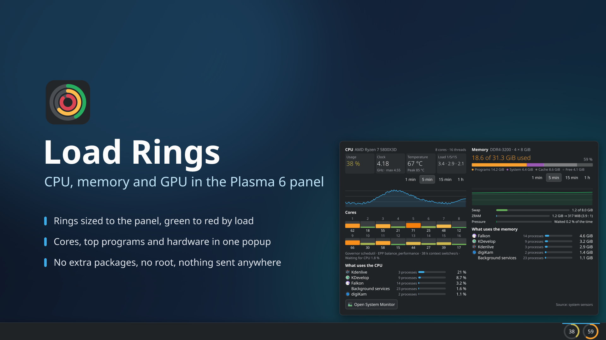
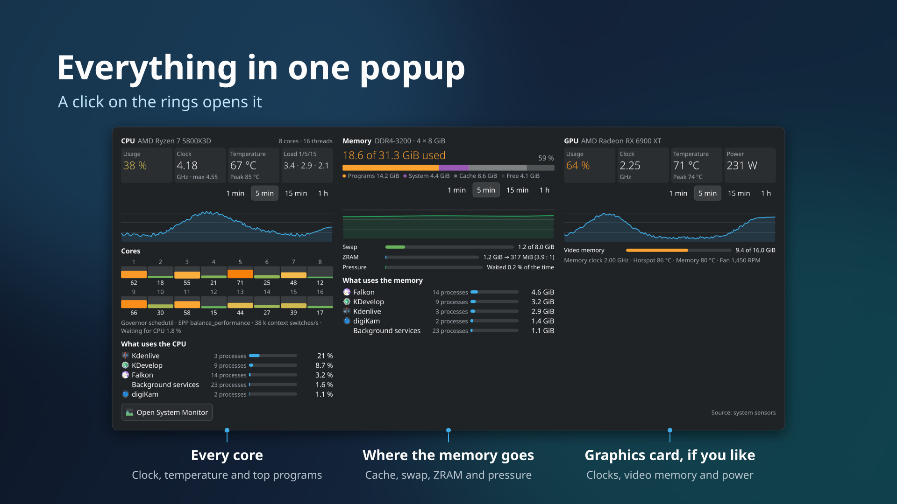
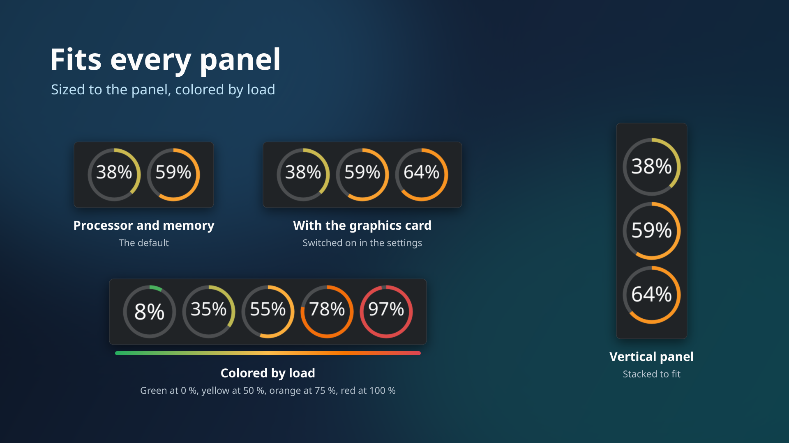
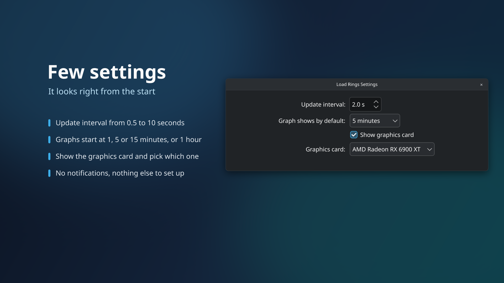
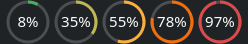
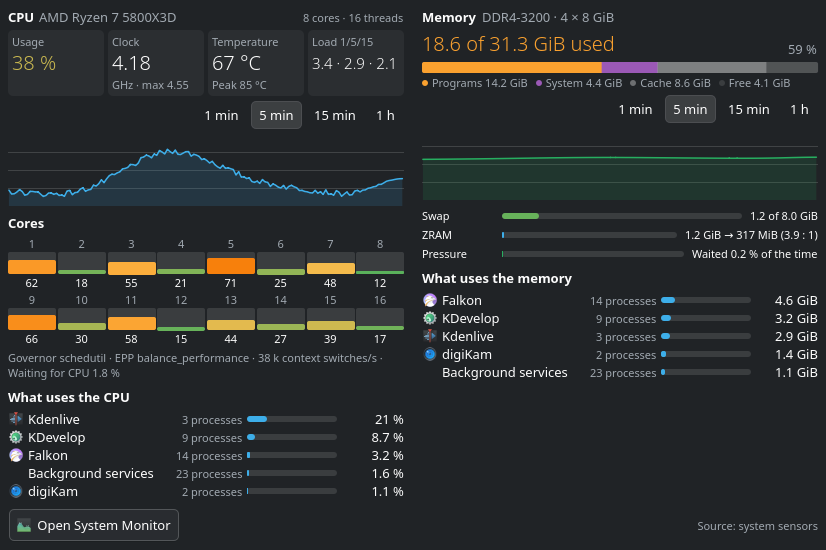
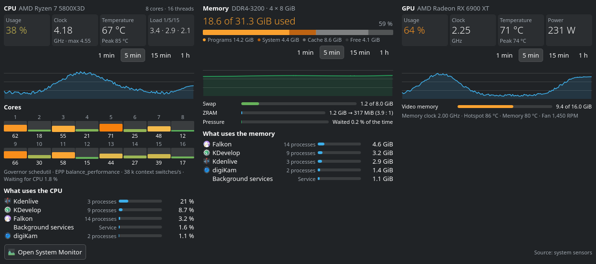
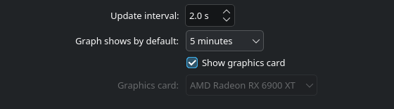

<!--
SPDX-License-Identifier: GPL-2.0-or-later
SPDX-FileCopyrightText: 2026 Flexomatic81
-->

<p align="center">
  
</p>

<h1 align="center">Load Rings</h1>

<p align="center">
  CPU, memory and GPU load as colored rings in the KDE Plasma 6 panel, with a popup for the details.
</p>

<p align="center">
  <a href="https://github.com/Flexomatic81/load-rings/actions/workflows/ci.yml"></a>
  <a href="https://github.com/Flexomatic81/load-rings/releases/latest"></a>
  
  <a href="LICENSE"></a>
</p>

<p align="center">
  
  <br>
  <sub>All screenshots show sample data.</sub>
</p>

## Quick start

Requires KDE Plasma 6.3 or newer. Download `loadrings-0.1.0.plasmoid` from the
[releases page](https://github.com/Flexomatic81/load-rings/releases), then
right-click the panel → "Add Widgets…" → "Get New Widgets…" → "Install Widget
From Local File…" and pick the file. Search for **Load Rings** in the widget
list and drag it onto a panel. Other ways to install: see
[Installation](#installation).

## About

The panel shows one ring per device: the processor, the memory and, if you
like, the graphics card. Each ring fills with the current load, shows it as a
number in the middle and changes its color from green through yellow and
orange to red as the load rises. The rings follow the size of the panel, in a
row in a horizontal panel and stacked in a vertical one.

A click opens a popup with one column per device: the figures, a graph of the
last minutes, the load of every core, where the memory goes, and the programs
that use the most. Everything comes from what a standard Plasma installation
already has; the widget needs no extra packages and no root rights, and it
sends nothing anywhere.

It is written in plain QML and JavaScript (no C++), so it installs like any
other widget.

## Screenshots

| | |
|---|---|
|  |  |
|  | |

These are the images of the KDE Store page, in [`docs/store/`](docs/store/);
how they are put together is described in [`docs/store.md`](docs/store.md#images).

The views at their real size are made from fixed demo data in the stock Breeze
Dark color scheme with `scripts/screenshots.sh` and live in
[`docs/images/`](docs/images/); the same images in Breeze Light are in
[`docs/images/light/`](docs/images/light/) (`scripts/screenshots.sh --light`).
The demo machine is an AMD Ryzen 7 5800X3D (8 cores, 16 threads) with
DDR4-3200 memory (4 × 8 GiB) and an AMD Radeon RX 6900 XT.

| | |
|---|---|
|  | `panel.png`: the processor and memory rings in a horizontal panel |
|  | `panel-gpu.png`: with the graphics card |
|  | `panel-vertical.png`: a vertical panel |
|  | `panel-colors.png`: the colors from low to high load |
|  | `popup.png`: the popup with the processor and memory columns |
|  | `popup-gpu.png`: the popup with the graphics card column |
|  | `settings.png`: the settings page |

## Features

- **Rings in the panel** for the processor and the memory, and optionally the
  graphics card. The number in the middle is the load in percent; a ring
  without a value shows a dash.
- **Colors by load:** green at 0 %, yellow at 50 %, orange at 75 % and red at
  100 %, blended in between. The color follows the load only, not the
  temperature.
- **Fits the panel:** the rings take the thickness of the panel, side by side
  in a horizontal panel and stacked in a vertical one. On the desktop they
  sit side by side.
- **Tooltip** with one line per device: load, clock and temperature of the
  processor, used memory, and load and temperature of the graphics card.
- **Popup** with one column per device, see below.
- **Calm numbers:** the digits have a fixed width, so the values do not make
  the layout jump.
- **Missing sensors are left out:** a machine without a temperature sensor,
  ZRAM, pressure information or a graphics card simply shows fewer lines; a
  value that is not there shows a dash, never an empty column or an error.
  When the system sensors stop answering, the rings and the popup show dashes
  instead of frozen values, and they recover on their own.
- **Translations:** English and German, by the system language.

### Popup

A click on the rings opens the popup; a second click closes it. The columns:

- **CPU:** the processor model with its cores and threads, the usage, the
  average clock with the maximum, the temperature with the peak since the
  widget started, and the load average over 1, 5 and 15 minutes. A graph of
  the usage over 1, 5 or 15 minutes or 1 hour. A grid with the load of every
  logical core; hovering a core shows its clock and temperature. A line with
  the frequency governor, the energy preference, the context switches per
  second and how long tasks waited for the processor. The five programs that
  use the most of it.
- **Memory:** the type, speed and modules (for example "DDR4-3200 · 4 × 8 GiB")
  where the firmware tells them, the used memory and its share, and a bar
  split into programs, system, cache and free. A graph of the use. Swap,
  ZRAM (original and compressed size) and how long tasks waited for memory,
  each only where the system has it. The five programs that use the most.
- **GPU** (when switched on in the settings): the name of the card, the usage,
  the clock, the temperature with the peak and the power draw, a graph, the
  video memory, and a line with the memory clock, the hotspot and memory
  temperatures and the fan.

The figures for the processor and the memory share one meaning with the rings:
the processor share of a program is a share of the whole processor, and the
used memory is the memory in use without the cache.

**Programs:** the processes are grouped by application, so a browser with
fourteen processes is one row. The services of your session are collected in
one row, "Background services". System services (the ones of `system.slice`)
cannot be listed by KDE's process model without root rights and are not shown.

The footer has an "Open System Monitor" button and names the data source.

The time window of the graphs can be switched in the popup; the history is
kept in memory for up to an hour and starts empty when Plasma starts.

## Settings

The settings page has four options; nothing has to be set up for the widget to
work.

| Option | Meaning |
|---|---|
| "Update interval:" | How often the values update: 0.5 to 10 seconds, default 2. |
| "Graph shows by default:" | The time window the graphs open with: "1 minute", "5 minutes", "15 minutes" or "1 hour"; default 5 minutes. A choice in the popup is not stored. |
| "Show graphics card" | Adds a ring and a popup column for the graphics card; off by default. |
| "Graphics card:" | Which card to show when the machine has more than one. "No graphics card found" says that the system sensors report none. |

The widget sends no notifications and cannot end processes; that stays with
the System Monitor.

## Data sources, and what the widget never does

Load Rings reads only what a standard Plasma installation provides:

- **System sensors (`ksystemstats`)** for the rings, the tooltip and most
  figures of the popup: usage, clock and temperature of the processor, the
  memory and swap, and the values of the graphics card. No process is started
  for an update. The sensors of the single cores are only read while the
  popup is open.
- **KDE's process model** (`org.kde.ksysguard.process`, part of libksysguard)
  for the programs in the popup. It is created when the popup opens and
  removed when it closes, so a closed popup reads no process list.
- **One short shell command** while the popup is open, through Plasma's
  executable data engine: it reads the load average, the context switches,
  the pressure information, part of `/proc/meminfo`, the ZRAM devices and the
  frequency governor from `/proc` and `/sys`. Once, when the popup first
  opens, a second one reads the processor model from `/proc/cpuinfo` and the
  memory modules (size, type, speed, maker, slot) from `udevadm`.

What it never does:

- It needs **no extra packages** and **no root rights**.
- It **sends nothing anywhere**: there is no network access at all.
- It **never reads serial numbers**: the memory query keeps only the fields
  listed above; serial numbers never reach the widget.
- It reads **no process list while the popup is closed**.
- It **keeps nothing on disk**: the history lives in memory only.

Without the executable data engine (`plasma5support`) the widget still loads
and shows the rings and the sensor values; only the parts from `/proc`, `/sys`
and `udevadm` are left out.

## Requirements

- KDE Plasma 6.3 or newer, with KDE Frameworks 6.10 and Qt 6.7 or newer.
  Tested on Plasma 6.8; older versions are not tested (see
  [docs/compatibility.md](docs/compatibility.md)). The widget declares API 6.0
  in its metadata; that value names the applet API generation, not the
  minimum.
- Nothing else: `ksystemstats`, libksysguard and `plasma5support` come with
  Plasma.

## Installation

### Package file (`.plasmoid`)

Download `loadrings-0.1.0.plasmoid` from the releases page of the project.
In "Add Widgets…" choose "Get New Widgets…" › "Install Widget From Local
File…" and pick the file, or install it in a terminal:

```sh
kpackagetool6 -t Plasma/Applet -i loadrings-0.1.0.plasmoid
# update an existing installation:
kpackagetool6 -t Plasma/Applet -u loadrings-0.1.0.plasmoid
```

If the widget does not show up in the list, restart the panel:
`systemctl --user restart plasma-plasmashell`.

You can build the file yourself: `scripts/build-plasmoid.sh 0.1.0` writes
`dist/loadrings-0.1.0.plasmoid` (needs `gettext` and `libarchive`).

### From source

```sh
git clone https://github.com/Flexomatic81/load-rings.git
cd load-rings
scripts/dev-install.sh
```

The script compiles the translations and installs the widget into
`~/.local/share/plasma/plasmoids`. A running panel keeps the old version until
plasmashell restarts. `scripts/run.sh` opens the installed widget in its own
window instead.

## Translating

All visible texts go through KDE's `i18n` functions, translation domain
`plasma_applet_io.github.flexomatic81.loadrings`. The message template is
`po/plasma_applet_io.github.flexomatic81.loadrings.pot`, the translations
live in `po/<language>/plasma_applet_io.github.flexomatic81.loadrings.po`.

```sh
scripts/Messages.sh      # extract the texts, merge into all translations
```

To add a language, create the file from the template, translate it and open a
pull request:

```sh
mkdir po/fr
msginit --no-translator --locale=fr --input=po/plasma_applet_io.github.flexomatic81.loadrings.pot \
  --output=po/fr/plasma_applet_io.github.flexomatic81.loadrings.po
```

`scripts/build-mo.sh` compiles the translations into the package
(`scripts/dev-install.sh` and `scripts/build-plasmoid.sh` call it for you).

## Contributing

Bug reports, ideas, translations and pull requests are welcome. Please use the
[issue forms](https://github.com/Flexomatic81/load-rings/issues/new/choose) and
open pull requests against the `dev` branch; [CONTRIBUTING.md](CONTRIBUTING.md)
explains the setup, the checks and the ground rules. Security problems are
reported privately, see [SECURITY.md](SECURITY.md). Everyone taking part
follows the [code of conduct](CODE_OF_CONDUCT.md).

## Development

`node tools/check.mjs` is the one entry point; CI runs the same steps.

| Command | Purpose |
|---|---|
| `node tools/check.mjs` | All steps: `eslint`, `format`, `test`, `qmllint`, `shellcheck`, `actionlint`, `smoke`, `load` |
| `node tools/check.mjs fast` | Group `fast`: the Node checks (`eslint`, `format`, `test` with its coverage floor); a few seconds |
| `node tools/check.mjs <step>...` | Only the named steps, e.g. `qmllint` or `shellcheck qmllint` |
| `node tools/check.mjs --install-hook` | Installs a pre-commit hook that runs the `fast` group |
| `pnpm test` | Only the unit tests of the logic modules (`package/contents/code/*.mjs`) |
| `scripts/smoke.sh` | QML smoke scenes with `qml6`; local only, the live scenes need `ksystemstats` and a desktop session (`LOADRINGS_SMOKE_SKIP_LIVE=1` skips them) |
| `scripts/load-check.sh` | Starts the installed widget offscreen and checks that it loads; needs a desktop session |
| `scripts/build-plasmoid.sh <version>` | Builds `dist/loadrings-<version>.plasmoid` |
| `scripts/release-check.sh <version>` | Checks the release gates: version, changelog, screenshots, release record |
| `scripts/screenshots.sh` | Renders the screenshots in `docs/images/` from demo data in Breeze Dark (`--light`: Breeze Light, into `docs/images/light/`; `--store`: three times the size, into `docs/store/shots/`); no window opens |

Run `pnpm install --frozen-lockfile` once for the Node tools. `qmllint` needs
the Qt 6 tool (`/usr/lib/qt6/bin/qmllint`); locally, steps that need Qt or a
desktop session are reported as skipped. In CI a missing `qmllint` fails the
run, and `smoke` and `load` are skipped. See
[CONTRIBUTING.md](CONTRIBUTING.md) for the workflow.

Continuous integration (`.github/workflows/ci.yml`) runs the `fast` group on
Node 22.13 and 24, shellcheck, actionlint and `qmllint`, and builds the
`.plasmoid` for version tags. [docs/testing.md](docs/testing.md) is the manual
checklist that is worked through before each release, and
[docs/compatibility.md](docs/compatibility.md) lists what the oldest supported
Plasma must provide.

## License

GPL-2.0-or-later. See [LICENSE](LICENSE).

Copyright 2026 Flexomatic81.
